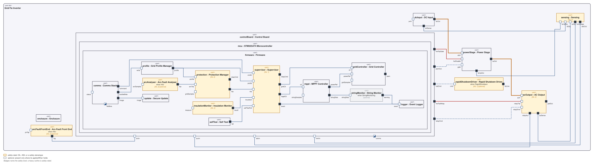

Internal block view: power, sensing, control and protection. Generated from the model, not drawn: it is the derived `GtiIbd` exported with `syscribe -m model_gti diagram export Diagrams::GtiIbd --format svg --out model_gti/Diagrams/GtiInternalBlockView.svg`. `GtiIbd` sets `depth: 2`, so the firmware (a deployment package allocated to the STM32 in `Allocations/FirmwareToMcu.md`) is drawn inside the MCU inside the control board with its own components; the safety-rated parts (`silLevel:`) are outlined amber with their level, and the arc-fault and rapid-shutdown parts (`appliesWhen:`) are badged optional. `--config CONF-GTI-IN-M2-001` drops those two. The lines carry the `flowKind:` of each connection in `System/GridTieInverter.md`: power heavy orange, gate and relay commands dashed blue, the hardware trips red, sensing plain. The `[diagram.portSides]` rule in `.syscribe.toml` keeps the power path on the direction rule (in west, out east) and puts every sensing port on the south side, so the DC-to-AC path reads straight across.
